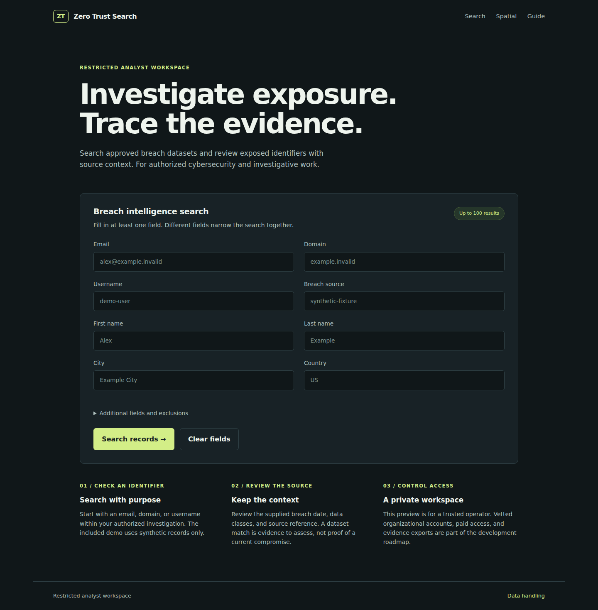

# Zero Trust Search

### Restricted breach intelligence for authorized analysts

Search approved breach datasets, review exposed identifiers, and inspect source context in a private workspace. This fork is being developed for **cybersecurity analysts, professional investigators, and law-enforcement users** with vetted organizational access.

**Status:** `2.0.0-dev.0` — single-operator modernization preview. The intended paid service still requires individual accounts, MFA, investigation scopes, audit trails, billing, and controlled evidence exports. See the [product plan](docs/PRODUCT.md).

[Get started](#get-started) · [Product direction](docs/PRODUCT.md) · [Development](docs/DEVELOPMENT.md) · [Operations](docs/OPERATIONS.md) · [API](docs/API.md) · [Security](SECURITY.md)

## What works today

| Capability | Current behavior |
| --- | --- |
| Identifier search | Email, domain, username, source, and other allowlisted fields with bounded results and pagination. |
| Precise email/domain matching | Whole identifiers matched without case sensitivity in the new schema; usernames preserve exact case. |
| Exposure context | Optional breach name/date, source reference, data classes, and a declared credential-exposure flag. |
| Record review | Escaped HTML or JSON output limited to approved display fields. |
| Spatial lookup | Validated coordinate/radius search against the local collection. |
| Operator access | Browser login and Bearer API authentication, request limits, private default network binding. |
| Repeatable operation | Locked builds, explicit schema bootstrap, persistent data, health checks, regression tests, and CI. |

The preview returns exposure metadata. It does **not** return plaintext passwords, raw source lines, or unrestricted indexed fields. Source metadata is supplied by the operator and must be evaluated in context.

## Interface preview



## Get started

Install Docker Engine or Docker Desktop with Docker Compose v2. On Windows, use WSL or Git Bash with Docker Desktop available.

```bash
git clone https://github.com/Legatto2/search.0t.rocks.git
cd search.0t.rocks
bash run.sh --sample
```

The startup script creates a private `.env` containing a random token, starts the internal services, initializes the schema, and imports **two fictional records**. It never overwrites an existing `.env` or deletes volumes. Omit `--sample` to begin with an empty collection.

Open **[http://127.0.0.1:3000](http://127.0.0.1:3000)**:

- **Username:** `operator`
- **Password:** the `API_TOKEN` value in your local `.env`
- **Demo search:** source `synthetic-fixture` or email `record-one@example.invalid`

If `.env` already exists, it must contain a valid token. Keep this instance local until the deployment and access requirements in the [operations guide](docs/OPERATIONS.md) are met. A shared operator token is not a customer account system.

> **Existing installation?** Read [MIGRATION.md](docs/MIGRATION.md) first. The new schema and API intentionally change behavior. Existing indexes are not automatically attached, converted, or deleted.

## Current technology

| Layer | Baseline |
| --- | --- |
| Runtime | Node.js **24.22.1 LTS** |
| Application | Express **5.3.0**, TypeScript **7.0.2**, Mustache **4.2.0** |
| Browser | Local HTML, CSS, and JavaScript; no CDN or map-service dependency |
| Search | Apache Solr **9.11.0**, Apache ZooKeeper **3.9.6** |
| Delivery | Docker Compose, GitHub Actions, Dependabot |

Versions were verified on **October 22, 2026**. Solr 9.11 is an intentional maintenance bridge; Solr 10 is the current major and has a separate [migration plan](docs/OPERATIONS.md#version-policy-and-the-solr-10-migration). Container images and CI actions use verified immutable pins.

## Development and test data

Use the Node version in `.nvmrc`:

```bash
cd dataapp
npm ci --ignore-scripts
npm run check
npm audit --audit-level=high
```

The checks cover strict type checking, browser script syntax, application regression tests, and a production build. Database/bootstrap and container checks are documented separately. See [CONTRIBUTING.md](CONTRIBUTING.md) for the branch, review, and release workflow.

The inherited **75,739-record `sample.jsonl` is retained unchanged at the owner's request** for isolated corpus compatibility and performance testing. Treat it as potentially sensitive. Default CI uses the new fictional fixtures; the separate [corpus-testing workflow](docs/CORPUS-TESTING.md) requires explicit opt-in and produces aggregate output. Software licensing does not establish the provenance or redistribution rights of that dataset.

## Documentation

| Guide | Purpose |
| --- | --- |
| [Product and roadmap](docs/PRODUCT.md) | Professional audience, vetted access, analyst workflow, paid-service requirements, and release gates. |
| [Development pipeline](docs/DEVELOPMENT.md) | Reproducible local work, CI, dependency updates, review, and repository settings. |
| [Operations](docs/OPERATIONS.md) | Startup, schema, imports, storage, health, backup, and Solr upgrades. |
| [API reference](docs/API.md) | Authentication, queries, limits, results, and error behavior. |
| [Corpus testing](docs/CORPUS-TESTING.md) | Isolated compatibility and performance checks using the retained 75k dataset. |
| [Migration](docs/MIGRATION.md) | Breaking changes and how to protect an existing installation. |
| [Audit and validation](docs/AUDIT-2026-10-22.md) | Findings, remediation evidence, executed checks, and remaining limits. |
| [Upstream provenance](docs/UPSTREAM.md) | Original authorship, historical material, and license context. |

## License

[Apache License 2.0](LICENSE). Attribution and third-party notices are in [NOTICE](NOTICE) and the [upstream provenance document](docs/UPSTREAM.md). Software licensing does not grant rights to datasets. This project is not affiliated with Have I Been Pwned or the former upstream hosted service.
